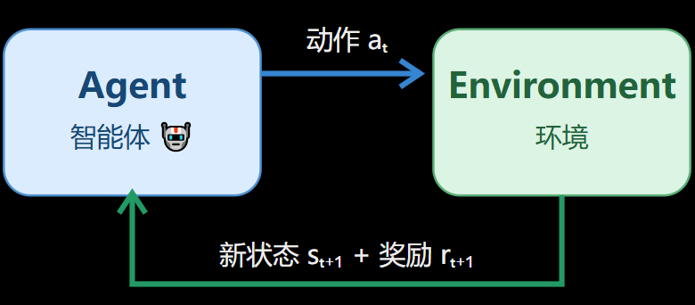

## 强化学习基础认知
### 认识强化学习、Agent、环境、状态、动作、奖励、回合、回报

---

#### 强化学习的定义
**智能体(Agent)**
通过与
**环境(Environment)**
不断交互，根据环境给予的
**奖励(Reward)**
，学习一种能够最大化*长期累积奖励*的行为
**策略(Policy)**。

#### Interaction Loop

强化学习算法流程：
观察 -> 行动 -> 获得反馈 -> 学习 -> 再次行动

- $s_t$：第$t$个时间步的状态
- $a_t$：第$t$个时间步采取的动作
- $r_{t+1}$：执行动作后得到的奖励

#### 一、状态(State)
智能体所处环境在某一时刻的情况

数学符号：
$$s_t$$
其中：
- $s$是State的缩写
- $t$表示当前时间步

#### 二、动作(Action)
动作是智能体在某个状态下做出的选择

数学符号：
$$a_t$$
其中：
- $a$是Action的缩写

> 如果A={1,2...}使用离散值表示动作，那么A是智能体所有允许动作构成的集合，即
**动作空间(Action Space)**。

强化学习中的动作通常分为两种类型：
1. **离散动作**
动作数量有限，能逐个列举
例如：向上、向下，或者游戏中的跳跃、攻击

2. **连续动作**
动作可以在某个数值范围内连续变化
例如：方向盘转动角度、机械臂关节控制量、机器人的电机输出

#### 三、奖励
奖励是环境对智能体行为结果提供的数值反阔

数学符号：
$$r_{t+1}$$
其中：
- $r$是Reward的缩写

奖励可以是正数、负数、0

*当前奖励高，不代表这个动作一定对未来有利*

#### 四、策略(Policy)
智能体在某个状态下，决定*采取什么动作的规则*

策略不是动作，而是采取动作的规则，是从状态到动作选择规则的映射。强化学习的核心目标，是找到能带来较高长期回报的策略。

数学符号：
$$\pi$$

**两种不同的策略**
1. 确定性策略
在某个状态下，策略总是选择同一个动作
例如：
$$a=\pi(s)$$

2. 随机策略
在某个状态下，机器人按照一定概率选择不同动作
例如：
$$\pi(a|s)=P(A_t=a|S_t=s)$$
读作：
在状态$s$下，选择动作$a$的概率

此处|表示“在......条件下”

#### 五、回合(Episode)
一个回合通常是指智能体从某个初始状态开始，经过一系列交互，直到任务终止的完整过程

不是所有强化学习任务都有自然的终点。例如，持续运行的设备控制可能属于连续任务

#### 六、回报(Return)
Reward和Return有什么区别：
Reward 是某一步得到的即时奖励，Return 是从某个时刻开始的未来累计奖励

通常使用$G$表示回报

在有限回合中，*未折扣*回报可以写为：
$$G_t=\sum_{k=t+1}^{T}r_k$$

为什么需要折扣因子？
在强化学习中，经常使用折扣回报：
$$
G_t=r_{t+1}+\gamma r_{t+2}+\gamma^2 r_{t+3}+...
$$
其中：
- $\gamma$为折扣因子

$\gamma$用于控制未来奖励在当前回报中的权重：
- $\gamma=0$：只考虑下一步奖励
- $\gamma=0.5$：越远的奖励权重衰减越快
- $\gamma=0.99$：较远的未来奖励仍然有较高权重
- $\gamma=1$：不进行折扣，适用于累计奖励有定义的情况

当折扣因子较小时，智能体更重视近期奖励；当折扣因子接近1时，较远未来的奖励仍然具有较大影响

对于过程序列：
$$
s_0,a_0,r_1,s_1,a_1,r_2,s_2,\dots
$$
该序列称为一条轨迹(Trajectory)

#### 奖励、回报与折扣因子
#### 一、奖励函数
在强化学习中，环境根据任务规则，在每次交互后返回奖励。我们通常把决定奖励数值的规则称为奖励函数(Reward Function)

简化表示为：
$$
r_{t+1}=R(s_t,a_t,s_{t+1})
$$

#### 二、累计回报
是用来衡量从当前时刻开始，未来能够累计获得多少奖励的指标

一般把未折扣的回报写成：
$$
G_t=\sum_{k=0}^{T-t-1}r_{t+k+1}
$$
其中：
|符号|含义|
|:---|:---|
$G_t$|从时间步$t$开始的回报
$r_{t+k+1}$|未来某一步收到的奖励
$T$|回合终止的时间步
$k$|用来依次遍历未来奖励的计数变量

#### 三、折扣因子
强化学习使用折扣因子控制未来奖励相对于近期奖励的重要程度

记作：
$$
\gamma
$$

通常：
$$
0<=\gamma<=1
$$

当$\gamma$越小，未来奖励权重衰减越快；当$\gamma$越接近1，未来奖励的权重衰减越慢

最常见的折扣回报公式是：
$$
G_t=\sum_{k=0}^{\infty}\gamma^kr_{t+k+1}
$$

折扣因子不是简单地改变奖励的大小，而是可能改变智能体认为哪条路线更值得选择

#### 四、回报公式的递归推导
已知折扣回报公式：
$$
G_t=r_t+1+\gamma r_{t+2}+\gamma^2 r_{t+3}+\dots
$$
把第一个奖励r_{t+1}单独保留，其他项提取一个$\gamma$：
$$
G_t=r_{t+1}+\gamma (r_{t+2}+\gamma r_{t+3}+\dots)
$$
其中括号中的部分是下一个时间步开始的回报$G_{t+1}$

因此：
$$
G_t=r_{t+1}+\gamma G_{t+1}
$$

由此得出：
**当前回报=当前收到的奖励+折扣后的未来回报**

#### 决策方式
两种不同的决策方式：
1. 利用(Exploitation)：选择当前看来收益最高的动作
2. 探索(Exploration)：尝试尚不确定的动作，获取更多信息

强化学习的难点不只是找到好动作，还要在探索与利用之间取得合理平衡。

首先要探讨的问题是如何估计一个动作的好坏？

一个最简单的方法是计算动作的样本平均奖励

一般写作：
$$
Q(a)=\frac{动作a获得的奖励总和}{动作a被选择的次数}
$$

如果一个动作从未尝试过，我们就没有其样本平均奖励，
因此智能体面临选择：
是继续选择当前估计值最高的动作，还是尝试信息不足的动作

#### 三种决策方法
三种决策方法包含怎么样选择*利用*和*探索*
#### 一、贪心策略(Greedy)
每次都选择当前估计奖励最高的动作
优点是简单，能够充分利用已经学到的信息
缺点是可能过早认定某个动作最好，错过其他潜在的优质动作

例如有动作A、B、C，假如B只尝试过依次，恰好得到很高的奖励；
C还没有充分探索。贪心策略可能一直选择B，而不尝试C

这叫**过早利用**

#### 二、随机探索(Random Exploration)
随机探索会随机选择动作，而不完全依赖当前估计值
例如对于A、B、C三个动作，三个动作的选择概率分别为：
$$
P(A)=P(B)=P(C)=\frac{1}{3}
$$
该方法有利于收集不同动作的信息，但如果长期完全随机，就可能反复选择奖励很低的动作

#### 三、$\epsilon$-greedy策略
核心规则：
- 以概率$\epsilon$进行探索，随机选择一个动作
- 以概率$1-\epsilon$进行利用，选择当前估计奖励最高的动作

可用简化表示为：
$$
\begin{cases}
随机选择动作 & 概率\epsilon \\
选择当前最优动作 & 概率1-\epsilon
\end{cases}
$$
这里$\epsilon$是探索率，
在实际强化学习中，其值可以变化

接下来将编写第一个强化学习程序，见
[老虎机](experiments/slot_machine.ipynb)

